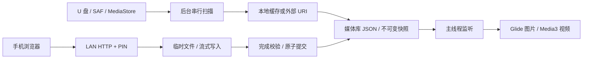

# 项目结构与关键实现

```text
app/src/main/java/com/tvcarousel/
  CarouselApp.kt             初始化偏好、日志、媒体库与崩溃恢复钩子
  player/PlayerActivity.kt   View + Glide + Media3，前后台资源释放
  media/MediaItem.kt         数据模型和自然排序
  media/MediaLibrary.kt      串行扫描、复制、JSON 索引、主线程变更通知
  usb/UsbMonitor.kt          挂载、弹出、卸载等系统广播
  upload/LanServer.kt        有界线程池 HTTP/1.1 服务，身份和请求校验
  upload/StreamTransfer.kt   Long 计数固定缓冲区流式传输
  settings/Config.kt         SharedPreferences 和 PIN 校验
  settings/SettingsActivity.kt 遥控器数字键盘、焦点、SAF 和系统设置入口
  boot/BootReceiver.kt       开机启动入口
  boot/CarouselService.kt    前台通知、USB 监听、网络和端口重试
  boot/Recovery.kt           限流的崩溃恢复闹钟
  orientation/RotatingActivity.kt 根容器旋转、尺寸和方向键映射
  logs/Logs.kt               有界滚动日志
app/src/main/assets/upload.html 手机上传和管理网页
app/src/test/java/com/tvcarousel/CoreTests.kt 关键算法及传输测试
```

单 app 模块按包分层，避免 API 23 项目引入不必要的多模块构建复杂度。媒体库不依赖服务端或数据库迁移，使用本地 JSON。视频与图片均由成熟库负责解码。

## 数据与线程



媒体项包含 id、uri、type、name、size、modified、addedAt、source。加入顺序由 addedAt 保留；展示顺序按设置实时生成。索引发布与上传提交 / 删除使用短同步区，文件上传本身不占用媒体库锁。扫描和清空串行执行；HTTP 请求走最多两个工作线程；UI 更新始终派发到主线程。

上传保存至私有 files/media，避免 scoped storage 写入问题。命名使用随机 UUID，目录中不采用客户端路径。扫描默认复制可移动媒体；直接模式使用持久化 SAF / 内容 URI。复制只在完整写入后 rename，UI 不读取 .part。

## 生命周期与异常

Activity onStart 创建播放器并监听媒体变化；onStop 清理 Handler、Glide 和播放器，避免退出设置 / 前后台切换造成重复播放或解码器泄漏。播放器请求使用 generation 标记，丢弃过期图片加载回调。Media3 结束后进入下一项，错误写日志并跳过，整轮失败延后重试。

服务在 onCreate 立即前台化，再启动网络和 USB 工作。网络断开关闭监听 Socket 和客户端连接，未完成上传清理；换 IP 自动重绑。广播合并短时间重复扫描请求，并在正在扫描时保留后续重扫请求。主线程不递归读取文件。

方向统一根布局旋转，90/270 度交换测量宽高，并反向映射 D-pad。TextureView 支持容器旋转；比例显示交给 ImageView / PlayerView，旋转不改写源媒体。

## 有意保留的边界

系统权限和文档界面不由 App 旋转；无 root 下无法绕过厂商后台和 U 盘权限。HTTP 为可信局域网设计，不含 TLS、续传或任意文件服务。每次扫描上限 20,000 媒体项 / 12 层。7×24 稳定性、硬件解码和系统自启动需要设备实测。
