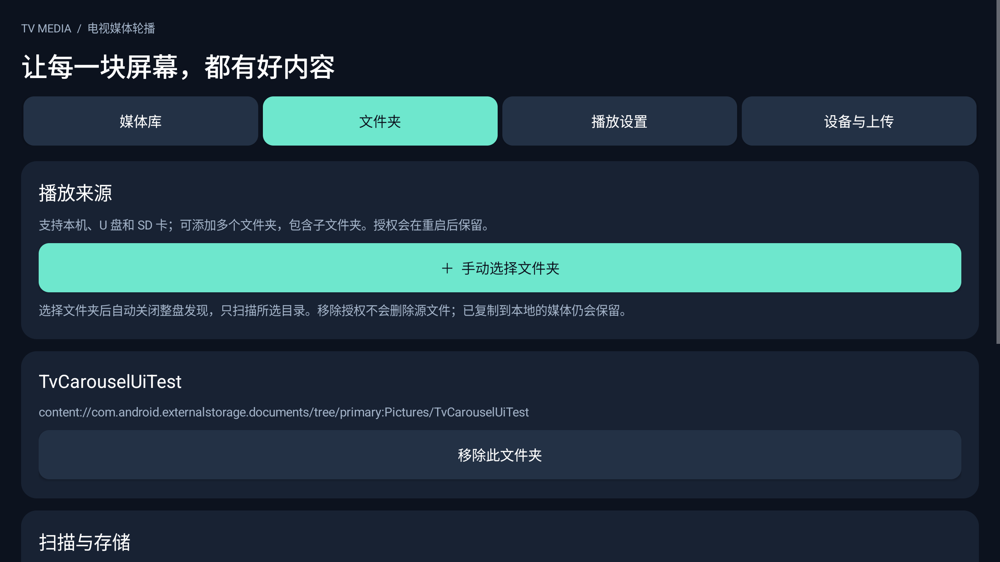
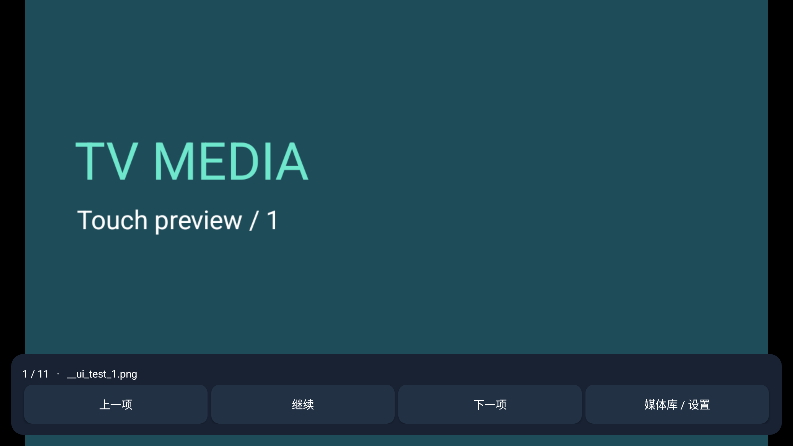
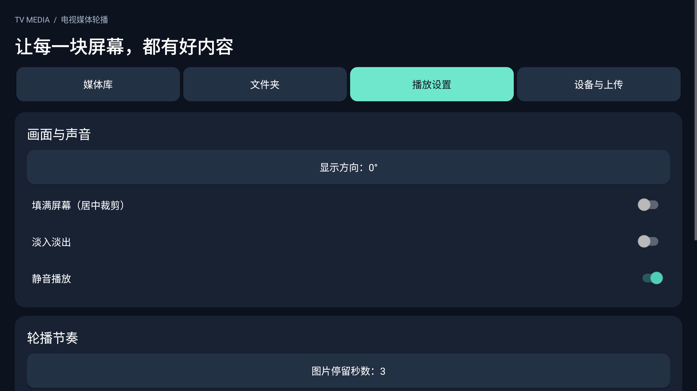
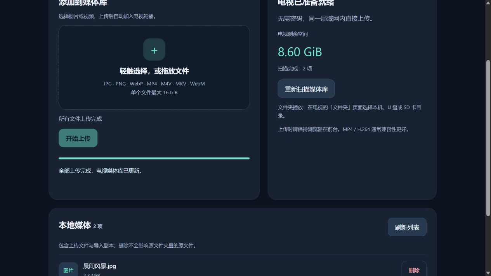

# 1.1.0 界面与操作

使用统一的深蓝背景、圆角卡片和薄荷绿主按钮。主要触控按钮最小高度 56dp，设置开关至少 60dp；遥控器焦点保留高对比描边。App 所有页面随根容器旋转。

1. 空库首页：品牌、引导、选择媒体文件夹和打开媒体库两个入口。
2. 播放页：全屏图片 / 视频；轻触显示当前文件、进度项号、上一项、暂停 / 继续、下一项、媒体库。菜单键直接进入工作台，上键显示并聚焦控制。控制栏 6 秒后隐藏，暂停时常驻。
3. 媒体库：图片 / 视频数量和剩余空间、添加文件夹、刷新、缩略图网格，每页 24 项，宽屏 4 列、窄屏 2 列。点文件按钮选择播放，或确认删除本地副本。
4. 文件夹：多个持久授权目录、移除确认、整盘发现开关、复制 / 直接播放开关、权限和刷新。
5. 播放设置：画面与声音、轮播节奏两张卡片。数字可通过系统输入框或屏幕数字键盘录入。
6. 设备与上传：实际上传地址、二维码、无密码访问说明、服务开关、端口、启动和日志维护。
7. 手机上传：响应式双栏 / 单栏卡片，拖放和多选、总字节进度、取消、继续剩余文件、空间与本地文件列表。

系统文件选择器和权限框使用设备本身的界面，不会随 App 根容器旋转。上传页截图 `upload-preview.png` / `upload-mobile.png` 使用本地预览夹具数据；App 实际截图见构建报告。

## MuMu 实际界面

## 手机上传预览（夹具数据）

## 1.1.2 遥控器页签

顶部页签左右键直接切换页面，不需要再按确认。下键进入当前页的操作区，上键从第一个操作返回当前页签。焦点为金黄色白边；屏幕旋转时左右 / 上下仍按内容阅读方向移动。1.1.2 仅编译，未运行测试，以上截图为历史版本。
